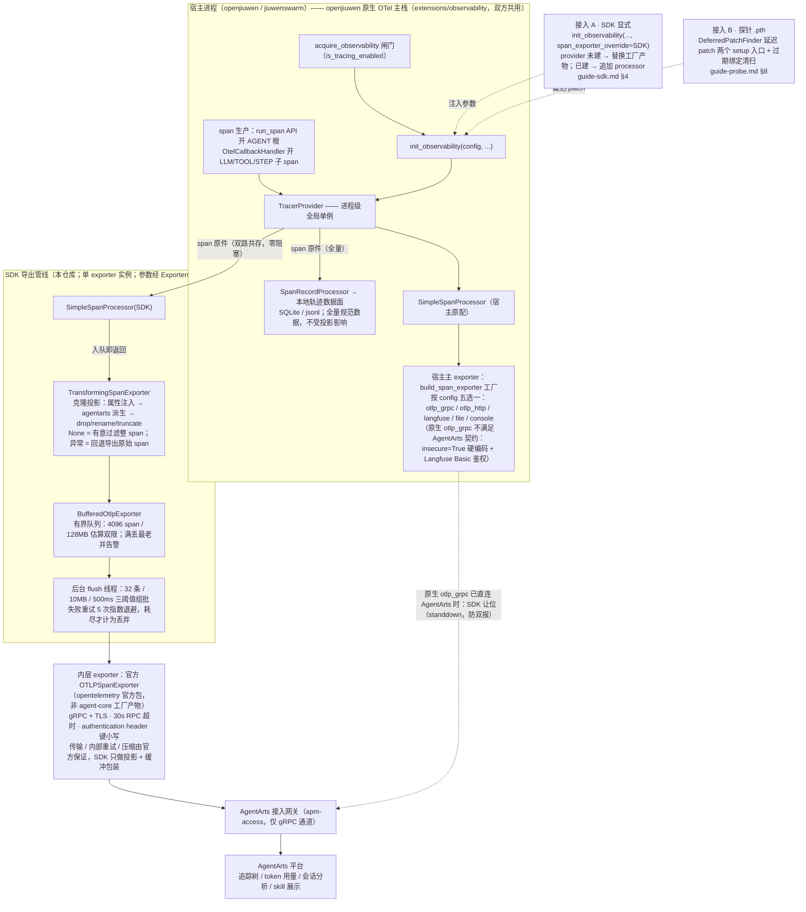

# agentarts-instrumentation-openjiuwen 设计文档

- 版本：v0.1（草案）
- 日期：2026-11-14
- 状态：待评审
- 类型：独立 SDK 仓库；对 jiuwenswarm / agent-core 无侵入集成

## 1. 背景与目标

### 1.1 背景

jiuwenswarm（宿主应用）经 pip 依赖 `openjiuwen`（即 agent-core 仓库）；两者共用同一套 OTel 主栈
（`openjiuwen/extensions/observability/`）：进程级全局单例 `TracerProvider`；exporter 由
`build_span_exporter` 工厂按 `ObservabilityConfig.exporter` 构造，支持
`otlp_grpc` / `otlp_http` / `langfuse` / `file` / `console` 五种——鉴权形态只有一种：langfuse pk:sk → Basic。

新需求：把第三方 agent 的观测数据上报到**华为云 AgentArts 智能体观测平台**（OTLP 接入；语义规范：
<https://support.huaweicloud.com/ops-agentarts/agentarts_14_0127.html>），要求如下：

1. 支持通用鉴权（Bearer / API-key / 自定义 header）；
2. 支持**属性投影/裁剪**，内置**华为 AgentArts 语义投影 preset**（§4.3）：
   回填 `gen_ai.span.kind`、`gen_ai.usage.total_tokens` 等平台必填字段，
   修正 `cache_write → cache_creation` 这类键名差异，从工具调用路径识别 Skill 读取并派生
   `gen_ai.skill.*`（不建独立 span），并裁剪可选的大体积属性；
3. 以**独立 SDK 仓库**形式交付，不改动 agent-core / jiuwenswarm 仓库；
4. 同一 SDK 同时服务 jiuwenswarm 与独立使用 openjiuwen 的场景（Team harness、
   单 Agent harness、RL、RSI 等）。

### 1.2 目标与非目标

**目标**

- 提供 `build_exporter(config) -> SpanExporter`，经 agent-core 官方注入参数
  `span_exporter_override` 挂入共享 provider；
- SDK 对 openjiuwen **零依赖**，只依赖官方 opentelemetry 包；
- 本地轨迹数据面（`SpanRecordProcessor` → SQLite → 轨迹 UI / 诊断）不受裁剪影响。

**非目标**

- 不做 metrics / logs 管道；
- 不做通用 OTLP receiver / collector；
- 不做属性投影之外的语义改写（如 GenAI semconv 演进）；
- 不修改 agent-core / jiuwenswarm 仓库代码（config.yaml 一等开关留作可选后续）。

## 2. 现状与可行性依据（以下均已对照代码核实）

### 2.1 注入点：`span_exporter_override` 是官方一等 API

```python
# agent-core: openjiuwen/extensions/observability/setup.py:21
def init_observability(
    config: ObservabilityConfig,
    *,
    span_exporter_override: SpanExporter | None = None,
    additional_span_processors: Sequence[SpanProcessor] = (),
) -> None: ...
```

关键行为（`openjiuwen/extensions/observability/runtime.py`）：

- **provider 尚不存在**：`exporter = span_exporter_override or build_span_exporter(config)`
  （runtime.py:158）；override **完全替换**工厂产物；
- **provider 已存在**（先到先得）：override **不会被丢弃**，而是追加一个
  `SimpleSpanProcessor(override)`（runtime.py:139-142；源码注释明说：
  "A later caller can still supply an exporter override that must not be dropped"）；
- Team 侧 `init_observability` 以相同签名透传 override
  （`openjiuwen/agent_teams/observability/setup.py:42-47`）。

> 结论：外部 exporter 的注入通道在 agent-core 中原生存在；SDK 完全不需要 agent-core 做任何改动。

### 2.2 版本兼容：一条宽松约束覆盖两套环境

| 环境 | opentelemetry 约束 | 来源 |
|---|---|---|
| jiuwenswarm（当前锁定 `f3f8f576`） | `>=1.25.0`；jiuwenswarm 自身锁 `>=1.28,<1.42` | jiuwenswarm pyproject.toml:62-65；f3f8f576 pyproject |
| agent-core HEAD | `>=1.45.1`（base），uv.lock 1.45.2 | agent-core pyproject.toml:86 |

`SpanExporter` / `ReadableSpan` 接口在整个 opentelemetry 1.x 线上稳定。把 SDK 约束设为
`>=1.25,<2.0` 即可同时装进两套环境，**绕开"必须升 jiuwenswarm otel 锁版本"的依赖升级
问题**（若直接改 agent-core 工厂则绕不开——这正是独立 SDK 路线的核心红利）。

### 2.3 限制：`acquire_observability` 包装不透传 override

harness（`openjiuwen/harness/observability/setup.py:72`）与 team
（`openjiuwen/agent_teams/observability/setup.py:87`）的按需包装只接收 `config`，
不接收 exporter 参数。因此，SDK 若要成为 jiuwenswarm config.yaml 的一等公民，
需要少量宿主侧胶水（见 §6.3，可选）。

## 3. SDK 结构

运行架构（两种接入形态、一条导出管线）：



要点：

- **与原生栈的关系是"共存而非替换"**（§7.1）：SDK 与宿主主 exporter 挂同一全局 provider 双路并行；本地轨迹数据面（SpanRecordProcessor → SQLite）始终拿全量原件——分流发生在 provider，投影只作用于导出克隆（§7.5）；
- **两代 OTLP exporter 是两个实例**：宿主原生 `otlp_grpc`（agent-core `build_span_exporter` 产物）不满足 AgentArts 契约；SDK 内层自行组装 **opentelemetry 官方包**的 gRPC exporter，只在其外做投影与缓冲包装；
- 凭证三来源（进程环境变量 > `AGENTARTS_ENV_FILE` > 宿主默认 env 文件）在接入组装时解析，探针形态见 guide-probe.md §3。

仓库布局（uv workspace，仓库根目录平铺）：

```
agentarts-instrumentation-python/
├── pyproject.toml                # workspace root: members = [core, openjiuwen]
├── core/                         # framework-agnostic kernel (workspace-internal, not published separately)
│   └── src/agentarts_instrumentation/
│       ├── config.py             # ExporterConfig: endpoint/protocol/headers/projection/batching params
│       ├── projection.py         # Projection model + derivation registry + project_span pipeline
│       ├── transform.py          # clone_readable_span + TransformingSpanExporter (copy-on-export)
│       ├── exporter/             # otlp.py (official exporter build) + buffer.py (BufferedOtlpExporter)
│       ├── factory.py            # build_exporter(config) -> SpanExporter
│       └── internal/             # credentials.py + inject.py (.pth installer + DeferredPatchFinder)
└── openjiuwen/                   # pip: agentarts-instrumentation-openjiuwen
    ├── src/agentarts_instrumentation/openjiuwen/
    │   ├── preset.py             # agentarts derivation: openjiuwen contract -> gen_ai.* platform semantics
    │   └── inject.py             # init_observability wrapper + inject/uninject command entries
    ├── docs/                     # this document, guides, 接入指南
    ├── examples/
    └── tests/
```

openjiuwen wheel **自包含**：hatch `force-include` 把 core 命名空间模块打进发行包，
用户只装一个包即可（无单独的 core 依赖）。

依赖（openjiuwen 胖 wheel）：

```toml
dependencies = [
    "opentelemetry-sdk>=1.25,<2.0",
    "opentelemetry-exporter-otlp-proto-http>=1.25,<2.0",
    "pydantic>=2.5,<3",
]
[project.optional-dependencies]
grpc = ["opentelemetry-exporter-otlp-proto-grpc>=1.25,<2.0"]
test = ["pytest>=7"]
```

- HTTP exporter 进基础依赖；gRPC（AgentArts 网关通道）作为 extra：
  `pip install "agentarts-instrumentation-openjiuwen[grpc]"`；
- 配置模型用 pydantic v2（与 agent-core / jiuwenswarm 生态一致）。

## 4. 组件设计

### 4.1 ExporterConfig（config.py）

```python
class ExporterConfig(BaseModel):
    endpoint: str = Field(min_length=1)    # OTLP endpoint (HTTP needs the full /v1/traces URL; gRPC takes host:port or a URL form)
    protocol: Literal["grpc", "http"] = "http"
    headers: dict[str, str] = Field(default_factory=dict)  # auth & custom headers, passed straight to the official exporter
    projection: Projection | None = None   # None disables projection (behavior identical to the official exporter)
    queue_size: int = Field(default=4096, ge=1)          # bounded queue capacity (count); evicts oldest when full
    queue_max_bytes: int = Field(default=134217728, ge=1024)  # bounded queue capacity (estimated bytes); same eviction
    batch_size: int = Field(default=32, ge=1)
    batch_max_bytes: int = Field(default=10_000_000, ge=1) # estimated byte cap per batch; a would-overflow span starts the next batch, an oversized single span ships alone (never dropped)
    flush_interval_ms: int = Field(default=500, ge=1)
    otlp_timeout_ms: int = Field(default=30000, ge=100)  # per-RPC timeout of the inner official exporter (incl. internal retries)
    export_attempts: int = Field(default=5, ge=1)          # total attempts per failed batch (exponential backoff 1/2/4/8s; drop only when exhausted)
    export_timeout_ms: int = Field(default=5000, ge=100) # shutdown/force_flush drain timeout, aligned with the main stack
```

### 4.2 Projection（projection.py）

```python
class Projection(BaseModel):
    preset: Literal["agentarts", "none"] = "none"   # agentarts = Huawei semantic preset (§4.3)
    attributes: dict[str, str] = Field(default_factory=dict)  # config-supplied common attributes, injected into every exported span
    drop: list[str] = Field(default_factory=list)    # exact key names, or prefix* matching (e.g. "gen_ai.input.messages*")
    truncate: int = Field(default=0, ge=0)           # 0 = no truncation; positive = string-value truncation at export time
    rename: dict[str, str] = Field(default_factory=dict)  # key renames (projection onto backend-expected names)
    service_name: str = ""                           # rewrites resource service.name on the exported clone (AgentArts requires AgentArts.<agent_id>.default)
    skill_path_patterns: list[str] = Field(default_factory=lambda: ["SKILL.md", "skills"])  # skill-detection path features (§4.3.5)
```

`project_span(span, projection) -> ReadableSpan | None` 是纯函数（绝不改动输入 span）；语义：

- `attributes`：先注入配置键（显式用户配置优先；绝不覆盖 span 已有键）；
- `preset="agentarts"`：应用华为语义派生与键名修正（§4.3）；
- `drop`：先精确匹配，再前缀匹配（`prefix*` 形式）；
- `truncate`：只截断字符串值；int/bool/list 不动；
- `rename`：键重命名；执行顺序为 inject → preset derive → drop → rename → truncate；
- 空配置 = 恒等直通（零开销短路）。

### 4.3 华为 AgentArts 语义映射 preset（preset: agentarts）

本节已拆分至 [agentarts-semantics.md](agentarts-semantics.md)（2026-11-27），**小节编号保持不变**——§4.3.1–§4.3.9 及代码注释中的 §4.3.x 引用在该文件仍然有效；外部规范引用（原附录 B）随迁。

### 4.4 transform.py：自包含克隆 + 包装器

独立实现 agent-core `extensions/observability/exporters/transforming.py` 的等价逻辑
（约 100 行）：`clone_readable_span`（全量 span 拷贝，只替换 attributes）+
`TransformingSpanExporter`（导出时逐 span 拷贝 + transform，带两条特殊语义：
**transform 抛异常时，回退为导出原始 span 并告警**——遥测绝不因投影失败而丢失；
**transform 返回 None 时有意过滤该 span**，供 preset 的整 span 裁剪 §4.3.7 使用）。

为何不导入 openjiuwen：SDK 零依赖（§5.1）；代价是逻辑重复（§9.1）。

### 4.5 BufferedOtlpExporter（exporter.py）——本 SDK 的核心

**为何必须内置批处理**：注入路径经过 `SimpleSpanProcessor`
（runtime.py:159-160）；span 一结束就**同步**调用 `exporter.export()`，官方
`BatchSpanProcessor` 的缓冲不在链路上。SDK 若只是包一层官方 exporter，网络 IO 会被
拉进业务线程，违反主栈不变式"span 导出绝不阻塞业务线程"。

结构：

```
SimpleSpanProcessor
  └─ BufferedOtlpExporter            # SDK self-contained
       ├─ bounded queue (queue_size)
       ├─ background flush thread    # takes batch_size items / batch_max_bytes est. bytes / flush_interval_ms, whichever first
       ├─ inner: official OTLPSpanExporter # retry / compression / protocol guaranteed upstream
       └─ Projection (optional; applied to the clone at enqueue or dequeue)
```

行为契约：

- `export(spans)`：克隆（若配置了投影）→ 入队 → **立即返回**，绝不阻塞调用方；
- 背压：队列满时**丢弃最老批次并告警**（沿用 jiuwenswarm 轨迹 sink 的有界队列
  模式）；绝不向业务流抛异常；
- `force_flush(timeout_millis)`：先排空队列（带期限；超时返回 False），再委托内层
  force_flush。注意：官方 OTLP exporter 是即发语义、**不提供 force_flush 方法**
  （实现期已验证）——内层方法存在则委托，否则把队列排空视为成功；
- `shutdown()`：排空（以 export_timeout_ms 为界）→ 关闭内层 exporter → 幂等
  （重复调用无副作用；教训来源：agent-core `279086272` 修复的 span 收尾泄漏类
  问题）；
- 投影在**入队前**执行（在调用导出的线程上做轻量克隆/丢弃；后台线程只负责序列化
  与发送）：入队前丢掉大体积属性可显著降低队列内存占用。

### 4.6 factory.py

```python
def build_exporter(config: ExporterConfig) -> SpanExporter:
    inner = _build_official_otlp_exporter(config)
    buffered = BufferedOtlpExporter(inner, config)
    projection = config.projection
    if projection is not None and _projection_active(projection):
        return TransformingSpanExporter(
            buffered,
            transform=lambda span: project_span(span, projection),
        )
    return buffered
```

## 5. 关键设计决策与理由

| # | 决策 | 理由 |
|---|---|---|
| 1 | 对 openjiuwen 零依赖 | 版本解耦（§2.2）：同时兼容 jiuwenswarm 旧环境与 agent-core 新环境；任何第三方 OTel 用户也能用 |
| 2 | 内置批缓冲 | SimpleSpanProcessor 的注入语义是同步调用（§4.5）；不阻塞业务线程是硬约束 |
| 3 | 投影跑在克隆上，绝不修改原始 span | `SpanRecordProcessor` / SQLite 轨迹库位于 processor 链另一分支，持续接收**全量规范数据**；轨迹 UI 与诊断不受裁剪影响 |
| 4 | transform 失败回退原始 span | 遥测不丢；与 agent-core 的 TransformingSpanExporter 语义一致 |
| 5 | 协议走官方 OTLP exporter（gRPC / HTTP-protobuf） | 重试、压缩、协议合规由上游保证；SDK 只叠加缓冲与投影 |
| 6 | header 原样透传（不限鉴权形态） | Basic / Bearer / x-api-key 全部由用户 headers 配置覆盖 |
| 7 | 宽松版本约束 `>=1.25,<2.0` | 接口在 1.x 全线稳定；三个环境（1.28 / 1.42 / 1.45）CI 验证 |
| 8 | 华为语义映射是**可配置 preset**（`preset: agentarts`）而非硬编码进 exporter | 平台规范"将随社区持续演进"（原文明说）；preset 规则必须能随版本演进；`preset: none` 时 SDK 就是普通的通用 OTLP exporter，非 AgentArts 用户不受华为语义影响 |
| 9 | preset 规则基于属性键数据契约（`openjiuwen.*` 属性值 + span 名），不导入 openjiuwen | 保持零依赖（决策 1）；与 jiuwenswarm 前端消费 semconv 常量的方式同构 |

## 6. 集成（已拆分至两份指南）

集成章节于 2026-11-27 拆分（原文编号在指南中标注）。代码/测试注释中的 §6.x 引用按下表定位：

| 原节 | 内容 | 现位置 |
|---|---|---|
| §6.1 | 独立 agent-core 零改动接入 | [guide-sdk.md](guide-sdk.md) §4.1（自建宿主） |
| §6.2 | jiuwenswarm 追加挂载（双路语义） | guide-sdk.md §4.2 |
| §6.2.1 | 集成陷阱：根 span 必须走 run span API（实测教训） | guide-sdk.md §4.4 |
| §6.3 | jiuwenswarm config.yaml 一等开关（可选后续） | guide-sdk.md §4.5 |
| §6.4 | 推荐配置示例 + 实测配方（gRPC/TLS、header 小写、service_name 504） | guide-sdk.md §5.1 |
| §6.5 | 服务式宿主运行时注入（.pth 机制；jiuwenswarm 实测配方） | [guide-probe.md](guide-probe.md) §8 |
| §6.5.1 | dev-stable 分支兼容性验证（五处差异与对策） | guide-probe.md §9 |
| §6.5.2 | 已知兼容性备忘 | guide-probe.md §9 |

## 7. 语义契约（SDK 对外的文档化承诺）

1. **共存而非替换**：override 与主 exporter 双路共存；仅当 SDK 是首个初始化者时
   才单路。集成顺序决定拓扑；宿主集成文档必须写明预期顺序。
2. **shutdown 传播链**：`provider.shutdown()` → `SimpleSpanProcessor.shutdown()` →
   SDK 的 `shutdown()` 排空。SDK 不参与按需计数；生命周期完全跟随共享 provider。
3. **热重载限制**：与主栈一致，exporter 每进程只构建一次；改配置需重启进程。
4. **背压语义**：队列满丢最老 + 告警；绝不阻塞、绝不向业务流抛异常。
5. **数据面隔离**：投影只影响 SDK 的导出克隆；`SpanRecordProcessor` / SQLite /
   轨迹 UI / 诊断始终看到全量规范数据。

## 8. 测试计划

| 层 | 内容 |
|---|---|
| 单元 | 投影语义（精确/前缀 drop、truncate、rename、空配置直通）；agentarts preset 断言（`gen_ai.span.kind` 派生覆盖六种 span 形态、`total_tokens` 回填、`cache_write→cache_creation`、公共属性注入、必填字段完备性检查）；skill 识别断言（让位检查——已存在 `gen_ai.skill.*` / `skill.loaded` 时不覆盖、跳过推断，`SKILL.md` / `skills` 目录段命中与未命中、name 提取、追加 `skill.loaded` 事件且不改原始 span 的 events、保守多命中策略、自定义 `skill_path_patterns`）；transform 失败回退；BufferedExporter 入队/批量 flush/背压丢弃/shutdown 排空与幂等/force_flush |
| 集成（agent-core） | `span_exporter_override` 注入：harness + team 双层；两种顺序——先建 provider 再追加 vs 未建；shutdown 传播；用真实 OtelCallbackHandler 产出的 span（AGENT/LLM/TOOL/STEP 四种）验证 preset 派生 |
| 生产管线 e2e（agent-core） | `tests/integration/test_production_pipeline.py`（P1–P6，FakeModelClient monkeypatch `create_model_client`——无网络、真实事件装饰链）：P1 完整生产顺序链（acquire 闸门 → SDK 追加双路 → 注册表 run-span 根 → 真实 LLM 事件 → handler 产子 span 成树 → 平台必填契约逐 span 断言 → 聚合/rename/usage 回填 → service_name 改写）；P2 裸 tracer 根反例（§6.2.1 陷阱回归守卫——子 span 丢失）；P3 失败传播（run span ERROR + status_message；实测：失败 LLM span 的 status 是 UNSET——仍导出且聚合链完好）；P4 多轮 trace 隔离（无跨 trace 聚合泄漏）；P6 生命周期收尾（shutdown 恰一次；所有 span flush） |
| 集成（jiuwenswarm） | file 主 exporter + SDK 双路 e2e；确认 SQLite 轨迹数据不受投影影响 |
| 安全/边界/可靠性 | `tests/test_security_and_edges.py`（21 例）：**安全**——header CRLF/控制字符注入在配置层被拒（`config.py` field_validator，gRPC metadata 拒大写键之外的第二道防线）、endpoint 非空、丢弃告警日志绝不包含 span 属性值（断言直接挂在 handler 上——凭证/敏感内容绝不进日志）；**边界**——Windows 反斜杠 skill 路径识别（主战场形态）、聚合器 LRU 逐出与 take 幂等、五种畸形 input.messages 形态——既不崩也不回填、Unicode 按字符截断、单批 1000 span 零丢失、shutdown 后 export FAILURE / 慢内层 force_flush 超时返回 False；**可靠性**——8 线程 × 800 span 并发，无重复、无丢失；内层持续失败后显式恢复（线程存活；批次持续到达）。测试设计说明：后台 `_take_batch` 是有啥拿啥（不等凑满 batch_size），所以**断言不得依赖批次划分**——用开关式失败窗口或慢内层 exporter 制造确定性 |
| 兼容性矩阵 | opentelemetry 1.28 / 1.42 / 1.45——三个环境跑完整单测套件（CI 三个作业）。**本地已验证（2026-11-14）**：1.28.0 与 1.42.0，各自在独立 venv 装官方全家桶（api/proto/sdk/otlp exporter 同版本）+ 源码安装 SDK，然后跑纯 SDK 测试组（unit + security/edge/reliability + 协议行，78 例）——**全部通过**；1.45.2 主环境通过全部 90。风险面（`SpanExporter`/`ReadableSpan` 接口、官方 OTLP exporter 构造签名 headers/timeout、proto 编码）三个版本无差异。CI 作业复用同一 venv 流程，永久化 |
| 实测（真实 AgentArts） | `tests/live/`（凭证环境变量驱动；缺失时整组跳过——对常规套件零影响）。**L1 静态全链路比对**（SDK 独立 provider 形态，三 span 嵌套树 → gRPC 上报 → KooCLI 轮询回显，断言树/类型/tokens/in-out → ShowOpsTrace 抽查 skill 字段；**平台子 span 的 session_id 为空，所以会话过滤只能定位根——树查询两步走：session→trace_id→全量过滤**）；**L2 鉴权反向**（错 token → 官方 exporter 返回 FAILURE → SDK 告警可见——exporter.py 返回值检查的实测验证，修复了后台线程吞返回值、丢批不可见的缺陷）；**L3 路由反向**（空 service_name → 网关 504 → 告警可见）。**L4 生产链实测**（`tests/live/test_production_live.py`：agent-core 生产顺序 + FakeModelClient（惰性分派确认 monkeypatch 后不碰 openai）→ 真实 gRPC → 平台回显断言跨 span 聚合/rename/usage 回填/树；每个测试自建 exporter 实例——不复用会话级 fixture，因为 SimpleSpanProcessor.shutdown 会传播并关掉 exporter）。**L5 真实 LLM 实测**（`tests/live/test_real_llm_live.py`，跨机实测：pytest 内在远程测试机执行真实 deepseek 生产顺序与上报，本机经 KooCLI 断言——两侧凭证均读自环境变量、绝不落盘；缺失即跳过）。断言：AGENT+LLM 成树；AGENT 输入跨 span 聚合非空；输出与真实答案完全相等；平台 token 数与 deepseek API 响应一致；LLM span 含真实答案。**已实测：5/5 通过（2026-11-14，实测组全绿）** |

## 9. 风险与遗留项

| # | 风险/代价 | 缓解 |
|---|---|---|
| 1 | clone/transform 逻辑与 agent-core 的 `transforming.py` 重复；语义可能漂移 | 语义简单（约 100 行）；集成测试覆盖回退；长期可下沉共享包（优化项，非前置条件） |
| 2 | `acquire_observability` 不透传 override；config.yaml 一等开关需要宿主胶水 | 按可选迭代处理；零改动路径（§6.2）先行 |
| 3 | SimpleSpanProcessor 同步链上 SDK 是唯一缓冲点；批实现质量决定背压行为 | 有界队列 + 丢弃告警契约 + 专项单测 |
| 4 | 官方 OTLP exporter 构造签名在 1.25–1.45 间有细微差异（如 headers/timeout 参数） | 兼容性矩阵 CI，三版本验证 |
| 5 | 华为规范部分键名映射由文档推断（`is_stream`、`tool.call.id`、`user.id` 派生源），skill 识别是启发式（路径参数键集合、`skills` 目录段命名）——实现期需对照真实 span + AgentArts 实测上报核对（§4.3.2/§4.3.5 已标注） | 实现期做一次真实上报验证（跑一次含真实 SKILL.md 读取的 agent 运行），对照平台看板回显；推断项与 `skill_path_patterns` 在代码中集中为常量表，便于修正 |
| 6 | 平台规范"将随社区持续演进"；映射规则有漂移风险 | preset 规则集中于 `projection.py` 常量表 + 按规范文档版本（2026-11-02）标注来源；升级走 SDK 版本发布 |
| 7 | ~~队列满丢弃按 span 逐条告警——突发载荷下日志风暴~~ **已修复**：切换为"定位要点"模式——首次丢弃立即告警（1 行）+ force_flush/shutdown 时汇总报告（新增/累计），正常运行期静默计数；契约由单测锁定（N 次丢弃 ≤ 4 行告警；汇总含累计数；告警不含 span 内容） | — |
| 8 | ~~otel 1.28/1.42 兼容性矩阵未验证~~ **已验证**：1.28.0 / 1.42.0，独立 venv 各 78 例全过（SDK 接口与官方 exporter 构造签名无版本差异）；1.45.2 主环境全过 89；CI 作业复用同一 venv 流程 | — |

## 10. 实施步骤

1. 仓库骨架（pyproject + src 布局 + CI）；
2. `config.py` / `projection.py` / `transform.py` + 单测；
3. `exporter.py`（BufferedOtlpExporter）+ `factory.py` + 单测；
4. agent-core 集成测试（双层、双顺序）；
5. jiuwenswarm 零改动集成验证（e2e）；
6. （可选迭代）jiuwenswarm config.yaml 一等开关胶水。

## 附录 A：关键代码依据

| 事实 | 位置（agent-core） |
|---|---|
| `init_observability` 支持 `span_exporter_override` | `openjiuwen/extensions/observability/setup.py:21-33` |
| provider 已存在时追加 `SimpleSpanProcessor(override)` | `openjiuwen/extensions/observability/runtime.py:134-142` |
| override 替换工厂产物 / 走 SimpleSpanProcessor | `openjiuwen/extensions/observability/runtime.py:158-162` |
| Team 侧同签名透传 | `openjiuwen/agent_teams/observability/setup.py:42-47` |
| 按需包装不透传 override | `openjiuwen/harness/observability/setup.py:72`；`openjiuwen/agent_teams/observability/setup.py:87` |
| exporter 工厂与现有五种类型 | `openjiuwen/extensions/observability/runtime.py:408-443` |
| TransformingSpanExporter 语义参照 | `openjiuwen/extensions/observability/exporters/transforming.py` |
| jiuwenswarm → ObservabilityConfig 映射 | `jiuwenswarm/agents/harness/observability_runtime.py:23-56` |
| GenAI 标准键生成与词表 | `openjiuwen/extensions/observability/gen_ai_semconv.py`（pin 修订生成）；`semconv.py`（`openjiuwen.*` 扩展键） |
| run 根 span 属性（trace.root / record.kind / turn.number / agent.mode） | `openjiuwen/harness/observability/run_span.py:69-169` |

